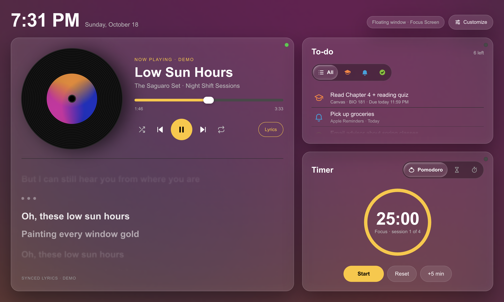

# Focus Screen

A desktop app that turns a second monitor into a study screen: what's playing with synced lyrics,
one to-do list from Canvas, Google Tasks, Apple Reminders and your own homework, and a Pomodoro
timer, plus your next class, the next bus, the weather and trip planning in the top bar.



Built with Electron, TypeScript and React. macOS first; Windows is planned but untested.

## What it does

- **Music:** Apple Music, Spotify, and YouTube Music through the included browser extension
  (Chrome and Safari; [how to add it](extension/README.md)). Cover, controls, and "Up next" for the song's last 20 seconds.
- **Lyrics:** synced lyrics from LRCLIB (VocaDB as a fallback) that glide like Apple Music's
  and light up word by word, with romaji under Japanese lines. There's also an editor for
  coloring lines by singer.
- **To-do:** Canvas (personal token or read-only calendar feed), Google Tasks, Apple Reminders,
  and homework and exam dates you add yourself.
- **Timer:** Pomodoro, countdown and stopwatch, with lengths set to the second.
- **Top bar:**
  - next class from Apple or Google Calendar, with a campus map of the building;
  - live Valley Metro bus times;
  - the weather from Open-Meteo;
  - a trip planner that runs on your computer.
- **Customize:** themes, glass cards, a card layout editor, and global hotkeys.

Some features are tied to Arizona State University and Phoenix's Valley Metro (campus maps, ASU
shuttles, bus times), because that's where it was built.

## Running it

You need Node.js 24 or newer and npm.

```bash
npm install
npm run dev
```

With no accounts connected, `npm run dev` shows a full demo screen: a made-up song with
lyrics, to-dos, a timer, and demo classes, buses and weather.

Other commands:

```bash
npm run typecheck
npm run lint
npm test
npm run build:extension   # the YouTube Music extension → extension/dist (Chrome: Load unpacked)
npm run build:mac         # a signed macOS app (needs Xcode and an Apple code-signing certificate)
```

The macOS helpers (Reminders, Calendar, location, audio) are small Swift apps in `native/`.
They need Xcode and macOS 12 or later (14.2 or later for the audio helper). The optional AI
add-ons are set up with `npm run setup:aligner` (lyrics auto-sync) and `npm run setup:covers`
(moving album covers). They download several GB of models and aren't needed for anything else.

## YouTube Music

YouTube Music needs the small browser extension in `extension/`, for Chrome, Edge, Brave, Arc or
Safari. It isn't in any extension store, so you build it once and pair it with the app using a
6-digit code. The steps are in **[extension/README.md](extension/README.md)**.

## Privacy

- No analytics, telemetry or crash reporting.
- Tokens are kept in the system keychain through Electron's `safeStorage`, never in files.
- Your to-dos, classes and location stay on your computer. The only outside services the app
  talks to are the ones it needs (LRCLIB, VocaDB, Canvas, Google, Valley Metro's open data,
  Open-Meteo, Apple Maps, ASU's public building list), each only with what that feature needs.
  `CLAUDE.md` lists every one and exactly what's sent.

## Project notes

- **`CLAUDE.md`:** the project's rules and design notes.
- **`project_brief.md`:** the original spec.
- **`docs/`:** the design docs and plans for each feature.
- **`design/`:** the HTML mockups.

Much of the app was written with AI coding assistants (Claude Code, with OpenAI's Codex on the
trip search).

## License

MIT. See `LICENSE`. Data and libraries by others are listed in `THIRD_PARTY_NOTICES.md`.

Not affiliated with Arizona State University, Valley Metro, Apple, Google, Instructure, Spotify,
SEGA or Colorful Palette.
